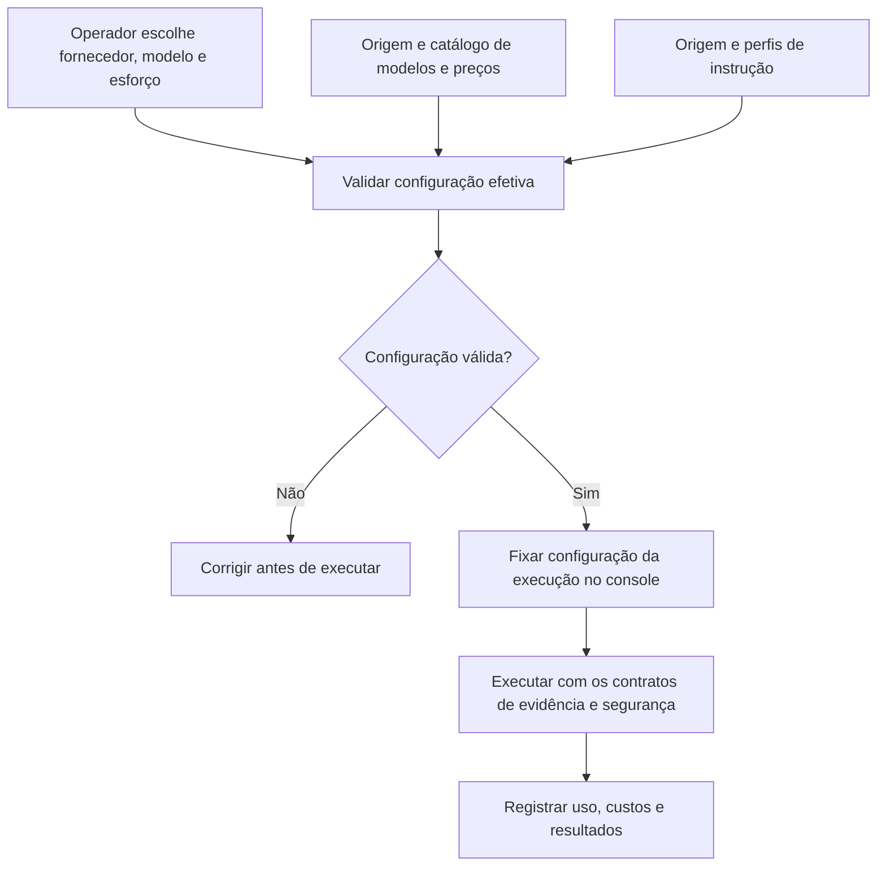

# Configuração operacional

O RASAi pode ser configurado por CLI, console interativo, arquivo INI do console e variáveis de ambiente. Credenciais permanecem fora do arquivo INI.

## O que o operador pode configurar

O console permite preparar a próxima auditoria, configurar credenciais e serviços, salvar parâmetros não secretos e restaurar padrões. A CLI oferece opções explícitas para parte dessas escolhas; os demais controles são variáveis de ambiente ou arquivos de configuração. Não trate todo o INI como entrada automática da CLI: existem leitores específicos, e a reprodução de uma sessão depende também dos argumentos e do ambiente efetivo.

| O que ajustar | Onde ajustar | Efeito |
| --- | --- | --- |
| URL, dispositivo, projeto, idioma, mercado, páginas e pasta de auditorias | Preparar auditoria ou CLI | Define escopo de aquisição, contexto e destino. Uma URL inicial e um dispositivo por execução. |
| Catálogos e autorização de IA | Preparar auditoria | Define plano interativo, dependências e supressão das capacidades opcionais não escolhidas. Não desliga todos os coletores basais. |
| Fornecedor, modelo e esforço de IA | Inteligência Artificial, variáveis por fornecedor ou CLI quando disponível | Define a seleção e parâmetros permitidos pelo adaptador existente. |
| Catálogo de modelos | Todas as configurações: origem/caminho; editar `config/ai-models.toml` | Habilita modelos e define seleção, vigência, esforço e elegibilidade; não cria novos adaptadores. |
| Catálogo de preços | Todas as configurações: origem/caminho; editar `config/ai-pricing.toml` | Define estimativas e ordenação econômica. Não altera a cobrança real do fornecedor. |
| Perfis de instrução de IA | Todas as configurações: origem/caminho; editar `config/ai-task-profiles.toml` | Define papel, objetivo, competências e orientação complementar por tarefa; não substitui contratos de evidência, segurança ou pontuação. |
| Integrações externas | Integrações e serviços; opções específicas dos catálogos; ambiente e CLI conforme o serviço | Habilita fontes e define quotas, limites e parâmetros. A presença da credencial não basta para todas as fontes. |
| Pesquisa SERP | Catálogo de inteligência de busca ou `--search-query` repetido e variáveis SERP | Solicita termos para uma nova auditoria, respeitando modo, fornecedor e tetos. |
| Pesquisa Perplexity | Catálogo de inteligência de busca; parâmetros de ambiente; confirmação específica | Separa habilitação, rascunho de termos, WEB/FAST e autorização da execução. |
| Apdex e perfis sintéticos | Preparar auditoria, CLI e ambiente | Define amostras, tentativas, carga, limites de tempo, perfis de cliente/hardware/rede e critérios de experiência. |
| Fuso de apresentação | Console ou `RASAI_PRESENTATION_TIMEZONE` | Altera a apresentação temporal, não a referência UTC de persistência. |

A relação exata de controles, tipos, valores e limites está na [referência de variáveis](ENVIRONMENT_VARIABLES.md). Veja também [exemplos de execução](CLI_REFERENCE.md#exemplos-de-execução-no-windows), [fluxo de catálogos](AUDIT_CATALOG_WORKFLOW.md) e [fuso horário](TIMEZONE_CONTRACT.md).

### Como a configuração de IA chega à execução



Para os três arquivos TOML, `factory` ignora o arquivo local, `file` exige um arquivo válido e `auto` usa o arquivo indicado quando presente, com retorno ao catálogo de fábrica na ausência. O console normalmente configura `auto` e os caminhos em `config/`. Fora dele, os leitores de modelos e preços usam `factory` se não houver seleção no ambiente ou INI; o leitor de perfis usa `auto`. Configure os caminhos explicitamente em automações para evitar dependência do diretório atual.

No console, a configuração dos três catálogos é validada e fixada em uma cópia temporária antes de iniciar a execução. Alterações posteriores no arquivo do operador passam a valer na próxima execução, não na que já começou. Os adaptadores, protocolos, esquemas de saída, regras de pontuação, limites de segurança e políticas de tratamento de falhas permanecem definidos pelo programa.

## Precedência prática

Para `rasai audit`, argumentos CLI explícitos prevalecem sobre variáveis de ambiente quando a opção possui equivalente CLI.

Para `rasai-console`:

A precedência depende da superfície e do momento. Na leitura de `[environment]`, o carregador preenche chaves reconhecidas ainda ausentes no processo; se a chave já existe, essa seção não a substitui, inclusive quando seu valor no processo é vazio. Os campos tipados são reconstruídos pelas próprias seções do INI. O bootstrap do console restaura overrides externos não vazios após carregar o INI; ao preparar a execução, a projeção dos campos gerenciados pelo estado pode escrever novamente as variáveis correspondentes. Portanto, comparar textos do INI e do ambiente não identifica sozinho o valor consumido pelo motor. Confira plano, argumentos, ambiente efetivo e snapshot da execução. Veja [contrato de persistência](CONSOLE_CONFIG_PERSISTENCE.md#precedência-e-limitações).

Alterações de sessão não equivalem a salvar o INI. Salvar persiste somente parâmetros não sensíveis; a persistência de credenciais no Windows/User é uma ação separada e explícita.

O console nunca grava API keys, OAuth tokens, senhas ou outras credenciais no INI.

## Referência canônica de variáveis

Consulte [`ENVIRONMENT_VARIABLES.md`](ENVIRONMENT_VARIABLES.md) para finalidade, tipo, domínio aceito, **default efetivo**, **valores permitidos**, **recomendação**, dependências e impacto operacional de cada variável.

Quando este guia resumido e `ENVIRONMENT_VARIABLES.md` divergirem, a referência detalhada deve ser reconciliada com o runtime; não se deve preservar um valor documental antigo apenas por compatibilidade textual.

## Menu de ambiente/credenciais

O console organiza a configuração por fronteira funcional. A composição vigente inclui configuração geral, IA, Search Intelligence/SERP, Web Performance/Google APIs, Synthetic Apdex e Browser/Playwright, além da visão de todas as variáveis e do atalho para documentação detalhada.

Em **Todas as configurações**, a seção **Configurações estruturais do console** também expõe **Raiz das auditorias**. Esse acesso reutiliza o mesmo `state.audits_root`, o mesmo editor e a mesma persistência já usados em **Preparar auditoria > Execução / armazenamento**; não existe segundo valor nem segundo mecanismo de gravação.

Secrets continuam fora do INI, independentemente do grupo em que aparecem.

## Arquivo INI do console

Arquivo padrão:

```text
rasai-console.ini
```

Pode armazenar entrada, projeto, idioma/mercado, `max-pages`, `audits-root`, device, configuração não sensível de IA, Web Performance e Synthetic Apdex.

Não armazena secrets como chaves de IA, tokens OAuth, passwords ou credenciais de integração.

## Valores padrão gerais

A tabela distingue o default do runtime/CLI bruto da baseline empacotada de uma nova sessão do console. Nenhum default substitui a revisão do plano, autorização de carga e configuração efetiva. Os demais valores da baseline estão em [padrões do sistema](SYSTEM_DEFAULTS.md).

| Configuração | Default efetivo | Valores permitidos | Recomendado |
|---|---|---|---|
| dispositivo | `mobile` | `mobile`, `desktop` | execute auditorias separadas para comparar dispositivos |
| provider de IA | `none` | `none`, providers/aliases do registry e `auto` | `none` sem necessidade semântica; `auto` quando houver múltiplos providers aptos e política de fallback desejada |
| remediação de conteúdo por IA | `false` | booleano | `false`; habilitar deliberadamente |
| remediação técnica por IA | `false` | booleano | `false`; habilitar deliberadamente |
| contexto editorial | `auto` | domínios definidos em `ENVIRONMENT_VARIABLES.md` | `auto`, salvo quando houver classificação humana conhecida |
| Web Performance | `false` | booleano | `false` por segurança de quota/custo; habilitar quando necessário |
| `max-pages` da auditoria | `100` | inteiro positivo conforme CLI | ajustar conscientemente ao escopo |
| Web Performance `max-pages` | `10` | inteiro `>= 0`; `0=todas` | `10` ou menor em smoke |
| timeout de Web Performance | `120 s` | número `> 0` | `120 s` |
| idioma | `pt-BR` | valor textual aceito pela configuração | `pt-BR` para o produto no Brasil |
| mercado | `BR` | valor textual aceito pela configuração | `BR` quando o mercado auditado for Brasil |
| `audits-root` | `audits` | caminho válido | default |
| Synthetic Navigation Apdex | CLI bruto `false`; baseline do console `true`, `T=3 s`, 150 amostras, até 188 tentativas | booleano | revisar carga e T antes de iniciar |
| Synthetic User Experience Apdex | CLI bruto `false`; baseline do console `true`, 100 amostras, até 125 tentativas | booleano | revisar carga e calibração antes de iniciar |

## IA

### Providers e aliases

Providers canônicos:

```text
openai
deepseek
mimo
xai
qwen
gemini
anthropic
mistral
cohere
kimi
copilot
```

Aliases CLI:

```text
grok           -> xai
claude         -> anthropic
moonshot       -> kimi
github-copilot -> copilot
```

A lista normativa vem do `provider_registry`; documentação e UIs devem projetar esse catálogo em vez de manter allowlists independentes.

Mistral usa `MISTRAL_API_KEY`, modelo público `mistral-small-2603` e endpoint global Standard fixo. Quando configurado e apto, participa de `AI=auto`.

Cohere usa `COHERE_API_KEY`, modelo `command-a-03-2025` e participa de `AI=auto` quando configurado e apto.

Kimi/Moonshot usa `MOONSHOT_API_KEY`, modelo `kimi-k3`, endpoint internacional fixo e reasoning `LOW|HIGH|MAX` com default `LOW`. Quando configurado e apto, participa de `AI=auto`.

GitHub Copilot usa o SDK oficial, `COPILOT_GITHUB_TOKEN` e modelo público `auto`. Quando configurado e apto, participa de `AI=auto`; use `RASAI_AI_AUTO_EXCLUDE=copilot` para excluí-lo sem remover a credencial. Instalação manual do transporte: `python -m pip install -e ".[copilot]"`.

### `AUTO`

`AI=auto` **não é uma cadeia fixa OpenAI → DeepSeek → MiMo** no runtime vigente.

O coordenador:

1. consulta o `provider_registry`;
2. considera todos os providers com `auto_eligible=true`;
3. exige credencial e configuração válidas;
4. aplica exclusões de `RASAI_AI_AUTO_EXCLUDE`;
5. remove candidatos já inelegíveis pela saúde/quarentena da execução;
6. estima o custo da necessidade atual usando provider, modelo, reasoning, input/output esperados, cache observado quando disponível e a regra tarifária vigente naquele instante;
7. ordena os providers precificados do menor para o maior custo estimado; providers sem preço conhecido ficam depois dos precificados e preservam entre si a ordem rotativa determinística do coordenador;
8. em cada ciclo, chama cada provider elegível no máximo uma vez;
9. repete somente em ciclo posterior, até `RASAI_AI_MAX_CYCLES`, com `RASAI_AI_CYCLE_DELAY_SECONDS` entre ciclos;
10. mantém falhas transitórias elegíveis e usa a janela 3/5 apenas como sinal de degradação; quarentena fica reservada a erro terminal normalizado;
11. encerra imediatamente quando a necessidade fica completa.

A ordem é recalculada a cada necessidade e pode mudar por horário, tamanho do request, modelo, reasoning, cache observado ou faixa de contexto. O runtime não troca silenciosamente para Batch, Flex ou outro service tier assíncrono somente para obter desconto.

Excluir um provider de `AUTO` não remove sua credencial nem impede seleção explícita posterior. Todos os providers integrados atuais podem entrar no pool quando configurados/aptos; exclusão operacional é feita por `RASAI_AI_AUTO_EXCLUDE`.

Preços, janelas tarifárias, timezone, heurísticas de tokens e política de revisão do catálogo estão em [`AUTO_COST_AWARE_AI_ROUTING.md`](AUTO_COST_AWARE_AI_ROUTING.md).

O mesmo catálogo de pricing também suporta políticas de **uso nativo não-token** em `[[native_usage]]`. Nesta versão, a baseline declara `PERPLEXITY_SEARCH_REQUEST`/`PER_REQUEST` e `MANUS_CREDIT`/`PROVIDER_CREDITS`. Isso é um contrato de pricing/telemetria: não adiciona `perplexity` nem `manus` à lista de providers selecionáveis acima. Operadores que customizam `config/ai-pricing.toml` devem manter unidade, superfície, fonte oficial, vigência e condições runtime coerentes; ausência de conversão monetária deve permanecer sem `currency`/regra em vez de receber valor zero.

### Modelos e reasoning

Os modelos públicos padrão e as opções de seleção de fábrica estão em [Modelos distribuídos na versão 1.0.0](AI_MODEL_CONFIGURATION.md#modelos-distribuídos-na-versão-100). Use `rasai providers --kind ai` para consultar os valores resolvidos no ambiente de execução. As variáveis por fornecedor são descritas na referência central de [variáveis de ambiente](ENVIRONMENT_VARIABLES.md#3-ia---modelos).

Os valores permitidos de reasoning são publicados em `ENVIRONMENT_VARIABLES.md` e `PROVIDER_REGISTRY.md`.

Para Cohere, pricing possui uma configuração adicional não secreta: `RASAI_COHERE_COMMERCIAL_MODE=UNKNOWN|TRIAL|PRODUCTION`. O default `UNKNOWN` preserva fail-closed; o operador deve escolher TRIAL ou PRODUCTION somente quando conhecer o tipo da key. Isso não altera modelo, reasoning ou evidence-bound; `UNKNOWN` mantém apenas o custo UNPRICED.

Política de default de reasoning: o RASAi usa o **menor nível válido que o modelo/API aceita**. Quando o provider permite desligar reasoning, o default é `NONE`; quando não permite, usa-se o menor effort disponível, como `LOW`; quando o adapter/modelo não expõe controle determinístico, permanece `PROVIDER_DEFAULT`. Isso é uma política RASAi de custo/eficiência e não uma afirmação sobre o default nativo do fornecedor.

### Política de execução de IA

| Variável | Default efetivo | Valores permitidos | Recomendado |
|---|---:|---|---|
| `RASAI_AI_TIMEOUT_SECONDS` | `180` | número finito `> 0`, em segundos | `180` |
| `RASAI_AI_MAX_CYCLES` | `3` | inteiro `1..10` | `3` |
| `RASAI_AI_CYCLE_DELAY_SECONDS` | `60` | número finito `0..300`, em segundos | `60` |

O timeout vale por tentativa externa. `max_cycles` vale por necessidade lógica de IA e reinicia em cada nova necessidade. A espera ocorre somente entre ciclos; não existe espera entre providers do mesmo ciclo. Um `Retry-After` transitório pode aumentar a espera efetiva até o cap canônico de 300 s.

AUTO e provider explícito usam essa mesma política. Na seleção explícita o pool contém apenas um provider; pricing continua sem funcionar como gate de admissão.

## Contexto editorial da IA - YMYL e E-E-A-T

Variáveis:

```text
RASAI_CONTENT_RISK_PROFILE
RASAI_YMYL_CATEGORY
RASAI_PAGE_PURPOSE
RASAI_INTENDED_AUDIENCE
RASAI_EXPERIENCE_REQUIREMENT
RASAI_FRESHNESS_SENSITIVITY
RASAI_CONTENT_ORIGIN
```

Todas usam `auto` quando ausentes. Os domínios completos de valores permitidos estão em [`ENVIRONMENT_VARIABLES.md`](ENVIRONMENT_VARIABLES.md).

Regras:

- valor explícito representa contexto fornecido pelo operador;
- `auto` permite somente hipótese provisória baseada nas evidências disponíveis;
- configuração explícita é preferível quando a classificação YMYL já é conhecida;
- campos `auto` não podem virar fatos sobre autoria, expertise, experiência, compliance, reputação ou processo editorial oculto;
- o contexto não cria score E-E-A-T/YMYL e não altera diretamente `SARI-001`/`SCORE-GEO-004`;
- essas variáveis não criam custo externo por si só: apenas condicionam chamadas de IA que já estejam habilitadas.

Base conceitual: [`CONTENT_ANALYSIS_CONTEXT.md`](CONTENT_ANALYSIS_CONTEXT.md).

## Remediação de conteúdo por IA

| Configuração | Default efetivo | Valores permitidos | Recomendado |
|---|---|---|---|
| `RASAI_AI_CONTENT_REMEDIATION` | `false` | booleano | `false`; habilitar quando houver provider apto e objetivo explícito de gerar sugestões |

Quando executada, `cat-09.html` e `ai-integrations.html` expõem provider, modelo, reasoning, tentativas/status, duração, tokens e custo estimado quando existe base confiável. O renderer usa provider/modelo persistidos e não possui allowlist específica para Copilot ou outros providers.

## Rastreamento, descoberta e acesso de crawlers

A camada determinística faz parte do pipeline. A IA técnica opcional usa:

```text
--ai-technical-remediation
--no-ai-technical-remediation
RASAI_AI_TECHNICAL_REMEDIATION
```

| Configuração | Default efetivo | Valores permitidos | Recomendado |
|---|---|---|---|
| `RASAI_AI_TECHNICAL_REMEDIATION` | `false` | booleano | `false`; habilitar somente quando orientação advisory por IA for desejada |

Precedência:

```text
CLI explícito > RASAI_AI_TECHNICAL_REMEDIATION > false
```

Essa finalidade é advisory, não altera scoring e não decide automaticamente política de crawler.

Página canônica:

```text
report-catalog/cat-01.html
```

## Search Intelligence / SERP

A coleta SERP é independente de SARI/SCORE-GEO-004. Providers live atuais:

| Provider | Credencial |
|---|---|
| `serpapi` | `RASAI_SERPAPI_API_KEY` |
| `serpapi-bing` | `RASAI_SERPAPI_API_KEY` |
| `zenserp` | `RASAI_ZENSERP_API_KEY` |
| `scrapingdog` | `RASAI_SCRAPINGDOG_API_KEY` |

`RASAI_SERP_MODE` usa `disabled`, `live` ou `fixture`. O provider default permanece `serpapi` quando nenhuma seleção explícita é fornecida pelo fluxo correspondente.

O console mostra provider, variável esperada e URL oficial de cadastro/login. As ofertas gratuitas documentadas são limitadas; o RASAi não classifica nenhum provider SERP externo atual como gratuito e ilimitado. `RASAI_SERP_MAX_REQUESTS` limita tentativas HTTP do RASAi e não representa necessariamente créditos comerciais do fornecedor.

Referências: [`PROVIDER_SETUP.md`](PROVIDER_SETUP.md), [`CONSOLE_SEARCH_INTELLIGENCE.md`](CONSOLE_SEARCH_INTELLIGENCE.md) e [`ENVIRONMENT_VARIABLES.md`](ENVIRONMENT_VARIABLES.md).

## Web Performance, Lighthouse e CrUX

| Variável | Default efetivo | Valores permitidos | Recomendado |
|---|---|---|---|
| `RASAI_WEB_PERFORMANCE` | `false` | booleano | `false`; habilitar quando a coleta externa for necessária |
| `RASAI_WEB_PERFORMANCE_MAX_PAGES` | `10` | inteiro `>= 0`; `0=todas` | `10` ou menos em smoke |
| `RASAI_WEB_PERFORMANCE_TIMEOUT_SECONDS` | `120` | número `> 0` | `120` |
| `RASAI_WEB_PERFORMANCE_FIELD_SOURCE` | `auto` | `auto`, `pagespeed`, `crux`, `none` | `auto` |
| `RASAI_LIGHTHOUSE_CATEGORIES` | `performance,accessibility,best-practices,seo,agentic-browsing` | combinação CSV sem duplicatas dessas cinco categorias | default das cinco categorias |
| `RASAI_PAGESPEED_API_KEY` | sem default | API key válida | secret/env |
| `RASAI_CRUX_API_KEY` | sem default | API key válida | secret/env; obrigatória para `field_source=crux` |

`agentic-browsing` permanece experimental. Se a resposta não materializar a categoria, o valor correspondente permanece indisponível/`NULL`; a ausência não vira zero e não invalida as demais categorias.

## Search Console e Observability

Comandos observacionais do Search Console usam OAuth bearer token em runtime. Esse valor é temporário, não é API key e não deve ser gravado no INI, artifact, SQLite ou HTML.

Consulte [`MONITORING_OBSERVABILITY.md`](MONITORING_OBSERVABILITY.md) e [`ENVIRONMENT_VARIABLES.md`](ENVIRONMENT_VARIABLES.md).

## Synthetic Navigation Apdex

| Variável | Default efetivo | Valores permitidos | Recomendado |
|---|---|---|---|
| `RASAI_SYNTHETIC_APDEX` | CLI bruto `false`; console `true` | booleano | habilitar conforme a finalidade e carga autorizada |
| `RASAI_APDEX_THRESHOLD_SECONDS` | sem default no CLI bruto; console `3 s` | número finito `> 0` | usar SLO/KPM definido para o sistema |
| `RASAI_APDEX_SAMPLES_PER_CONTEXT` | `150` | inteiro `>= 1` | `150`; reduzir explicitamente para diagnóstico de baixa carga |
| `RASAI_APDEX_MAX_ATTEMPTS_PER_CONTEXT` | `ceil(1.25 × samples)` | inteiro positivo e validado pelo runtime | default derivado |
| `RASAI_APDEX_MAX_PAGES` | `1` | inteiro `>= 0`; `0=todas` | `1` como baseline de carga |
| `RASAI_APDEX_TIMEOUT_SECONDS` | `max(45, 4T + 5)` | número `> 4T` | default derivado |
| `RASAI_APDEX_DELAY_SECONDS` | `1` | número `>= 0` | `1` ou maior conforme sensibilidade do alvo |
| `RASAI_APDEX_CONCURRENCY` | `1` | inteiro `1..4` | `1`; `3..4` exigem delay >= `1 s` |
| `RASAI_APDEX_ACQUISITION_MODE` | `auto` | `auto`, `isolated` | `auto`; aplica o planner canônico e reutiliza apenas aquisição física comprovadamente compatível |

No CLI bruto, Synthetic Navigation Apdex exige `T` no argumento ou ambiente quando habilitado; o console fornece `T=3 s` pela baseline se não houver ajuste efetivo. Consulte [`SYNTHETIC_APDEX.md`](SYNTHETIC_APDEX.md).

`RASAI_APDEX_ACQUISITION_MODE` não unifica as métricas. Em `auto`, o engine canônico pode projetar uma ocorrência física compatível para CAT-06 e CAT-07 sem unificar seus evaluators; targets, thresholds e classificações permanecem independentes e ambos herdam o device único da AUD. `isolated` mantém aquisições físicas separadas.

## Synthetic User Experience Apdex

Os defaults, valores permitidos e recomendados dessa camada estão consolidados em [`SYNTHETIC_USER_EXPERIENCE_APDEX.md`](SYNTHETIC_USER_EXPERIENCE_APDEX.md) e [`ENVIRONMENT_VARIABLES.md`](ENVIRONMENT_VARIABLES.md). No runtime/CLI bruto, a ativação permanece opt-in; a baseline empacotada do console a habilita independentemente da navegação. Pode usar configuração Dynatrace importada quando explicitamente solicitada. A concorrência do Experience aceita `1..3`, mantém `1` como recomendado e exige delay >= `1 s` para o valor avançado `3`; sem override próprio, a herança de Navigation é limitada a `2`.

A origem dos defaults deve permanecer explícita. O baseline executável usa `USER_ACTION_DURATION` com `3 s / 12 s` como **fallback RASAi derivado da configuração Dynatrace Load**, pois o RASAi não reimplementa `VISUALLY_COMPLETE` com semântica proprietária. A política default de erros reproduzível usa JavaScript errors = `true`, request/HTTP/CSP errors qualificáveis = `true`, `console.error` = `false` e escopo de request = `all`; cancelamentos genéricos `net::ERR_ABORTED` de subrecursos permanecem diagnósticos por default e não são tratados como equivalência automática de request error Dynatrace. A captura reproduzível usa JavaScript = `true`, XMLHttpRequest = `true`, Fetch = `true`, `console.error` = `false` e máximo de `10` erros detalhados por página. Amostras, tentativas, páginas, device mix, sessão, settle, pacing, concorrência, timeout e perfis sintéticos permanecem **defaults operacionais RASAi**, não defaults Dynatrace.

## Dispositivo

| Variável | Default efetivo | Valores permitidos | Recomendado |
|---|---|---|---|
| `RASAI_DEVICE_CONTEXT` | `mobile` | `mobile`, `desktop` | execute uma auditoria por dispositivo |

## Persistência do console

O console usa `rasai-console.ini` ou o caminho indicado por `RASAI_CONSOLE_INI` como persistência de parâmetros não sensíveis. Não existe uma única ordem linear que descreva todos os consumidores. A distinção entre `[environment]`, campos tipados, bootstrap e projeção ao executor está na seção [precedência prática](#precedência-prática).

Valores não secretos do INI são projetados novamente para o ambiente dos adapters antes da execução. Assim, remediação de IA, timeout, máximo de ciclos, espera entre ciclos, modelo/reasoning selecionados, Web Performance e Synthetic Apdex podem sobreviver a salvar → fechar → reabrir. Os três parâmetros de execução de IA usam a mesma fonte de verdade no atalho de IA, em Todas as configurações, no snapshot da AUD e no RPR.

Secrets nunca entram no INI. No Windows, o console pode persistir/remover uma credencial no escopo `User` somente mediante ação explícita; `Windows/Machine` é observado, não administrado.

## Segurança

- use variáveis de ambiente ou secret manager apropriado;
- secrets não entram no INI;
- persistência Windows/User exige ação explícita;
- logs e relatórios não devem registrar secrets;
- credencial configurada não implica crédito/quota;
- variáveis persistidas não equivalem a secret manager;
- integrações derivadas não alteram silenciosamente o índice de prontidão ou a versão do método de pontuação de uma auditoria.

## Documentos relacionados

- [`ENVIRONMENT_VARIABLES.md`](ENVIRONMENT_VARIABLES.md)
- [`CONTENT_ANALYSIS_CONTEXT.md`](CONTENT_ANALYSIS_CONTEXT.md)
- [`INTERACTIVE_CONSOLE.md`](INTERACTIVE_CONSOLE.md)
- [`CLI_REFERENCE.md`](CLI_REFERENCE.md)
- [`AI_GUIDE.md`](AI_GUIDE.md)
- [`AI_RUNTIME_ORCHESTRATION.md`](AI_RUNTIME_ORCHESTRATION.md)
- [`AUTO_COST_AWARE_AI_ROUTING.md`](AUTO_COST_AWARE_AI_ROUTING.md)
- [`PROVIDER_REGISTRY.md`](PROVIDER_REGISTRY.md)
- [`PROVIDER_SETUP.md`](PROVIDER_SETUP.md)
- [`CONSOLE_SEARCH_INTELLIGENCE.md`](CONSOLE_SEARCH_INTELLIGENCE.md)
- [`GOOGLE_API_KEYS.md`](GOOGLE_API_KEYS.md)
- [`SYNTHETIC_APDEX.md`](SYNTHETIC_APDEX.md)
- [`SYNTHETIC_USER_EXPERIENCE_APDEX.md`](SYNTHETIC_USER_EXPERIENCE_APDEX.md)
- [`MONITORING_OBSERVABILITY.md`](MONITORING_OBSERVABILITY.md)
- [`specification/24_CRAWLING_DISCOVERY_AI_ACCESS.md`](specification/24_CRAWLING_DISCOVERY_AI_ACCESS.md)
