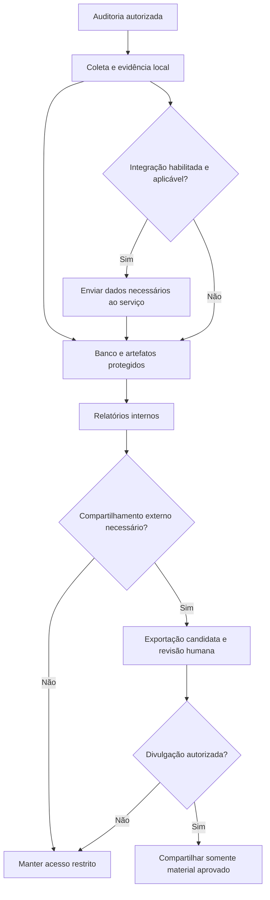

# Segurança da informação, credenciais e configuração

O RASAi separa configuração operacional de material sensível. O contrato público para configuração versionável de propriedade é `PROPERTY-CONFIG-001`.

Esta política é transversal: banco de dados, IA, SERP, Google APIs, OAuth, integrações e qualquer provider futuro seguem as mesmas regras.

## Quais dados são tratados e onde ficam

Esta declaração descreve a versão 1.0.0, não uma certificação de ausência de dados sensíveis. Uma auditoria pode conter informações comerciais e pessoais presentes nas páginas, nos resultados de busca, nas respostas de APIs ou nas evidências importadas. Dados públicos na origem não são automaticamente autorizados para qualquer finalidade de tratamento ou divulgação.

| Dados | Onde podem ficar registrados | O que pode sair do ambiente local |
| --- | --- | --- |
| URL, projeto, idioma, mercado, dispositivo, limites e preferências | INI do console (quando salvo), configuração da execução, banco e relatórios | URL e contexto necessários à coleta ou integração solicitada |
| Credenciais de API, OAuth, senhas e tokens | Ambiente do processo; Windows/User quando o operador autoriza persistência; mecanismo externo de segredos | Credencial necessária à autenticação perante o serviço correspondente |
| HTML recebido, texto, DOM, cabeçalhos, redirecionamentos e evidências de renderização | Banco e artefatos da auditoria, conforme aquisição e limites de cada coletor | Requisições ao site e aos recursos carregados; evidências selecionadas para análise por IA quando aplicável |
| Regras, achados, métricas, pontuações e recomendações | Banco, artefatos e projeções HTML | Conteúdo necessário à interpretação por IA, quando autorizada |
| Termos de pesquisa, região, resultados, trechos e fontes de busca | Configuração não secreta quando salva, banco e artefatos observacionais | Consultas e parâmetros enviados ao serviço SERP ou Perplexity quando solicitados |
| Métricas de desempenho e observabilidade | Banco, respostas JSON, CSV importado e banco auxiliar quando aplicável | URLs, origem e parâmetros a PageSpeed, CrUX, Common Crawl e demais serviços ativos; consultas a propriedades autorizadas em GSC/Clarity |
| IP público de saída e observações de rede | Artefatos de rede e relatórios derivados | A consulta de descoberta expõe o IP de saída ao serviço externo; sondagens complementares autorizadas podem contactar o destino |
| Comunicação com IA | Metadados de tentativas, uso, custos estimados e conteúdo sanitizado da comunicação, sujeito a limites | Instruções, evidências selecionadas e contexto para o fornecedor escolhido; a resposta retorna ao RASAi |
| Logs e comandos operacionais | Logs da auditoria e histórico de comandos separado | Nenhuma transmissão é inerente à mera gravação do log; executar o comando pode originar comunicações |
| Catálogo técnico e apresentação | Diretórios HTML, manifestos e anexos; o catálogo técnico inclui uma cópia probatória SQLite | Somente se o operador ou uma superfície autorizada compartilhar ou servir os arquivos |

A lista registra categorias de dados, não garante a presença de cada campo em todas as auditorias. Consulte [saídas e artefatos](OUTPUTS_AND_ARTIFACTS.md), [contexto de coleta](CAPTURE_CONTEXT_MODEL.md), [telemetria de IA](AI_RUNTIME_SECURITY.md) e [configuração de integrações](CONFIGURATION.md). Serviços opcionais têm pré-requisitos independentes: desabilitar IA não equivale a desabilitar toda comunicação externa.

### O que não deve ser gravado ou exibido

- Valores de credenciais não pertencem ao INI, TOML versionado, comandos copiados ou histórico de comandos. O transporte pode usar essas credenciais para autenticação; isso é diferente de registrá-las.
- O registrador de IA não copia cabeçalhos de autenticação para o histórico da comunicação; mascara campos reconhecidos como segredos e raciocínio privado.
- A interpretação editorial transitória tratada pelo registrador é removida da comunicação persistida e sua explicação pode aparecer no HTML final.
- O exportador de relatórios externos exclui o banco bruto, o diretório de integridade e outros formatos não permitidos. Não modifica o original.

Essas são fronteiras de implementação e política. O mascaramento por nomes, padrões e estrutura não identifica necessariamente todo segredo, dado pessoal, texto estratégico ou conteúdo opaco. Um banco histórico pode conter informações que já não aparecem no HTML atual. Não use ausência de alertas como prova de anonimização.

### Como controlar a exposição

Antes da auditoria, confirme o alvo autorizado, as fontes externas ativas, o propósito e as condições de envio de dados a cada fornecedor. A descoberta de IP público é habilitada por padrão; `RASAI_NETWORK_EGRESS_ENABLED=false` desliga essa descoberta, mas não toda a rede utilizada pela auditoria. As credenciais herdadas pelo processo não constituem, isoladamente, consentimento para consultas pagas.

A geração offline de relatórios a partir de uma auditoria existente não exige nova coleta. Reprocessamento, pesquisa complementar e nova inferência são operações diferentes e podem requerer rede e autorização.

### Retenção e compartilhamento

Proteja a pasta de auditorias, o banco, as cópias, os logs e os arquivos de configuração por permissões de acesso adequadas. A retenção do registro de IA acompanha a do espaço de trabalho; o limite de bytes por comunicação não equivale a um prazo de descarte. Este guia não afirma a existência de descarte automático universal, criptografia em repouso ou anonimização integral. Backups, armazenamento remoto, permissões, prazo de retenção e descarte devem ser definidos para a implantação real. A retenção e o tratamento pelo fornecedor externo dependem das condições do serviço contratado; não são controlados pela sanitização local do RASAi.

Não distribua o ZIP técnico integral: ele contém o snapshot SQLite probatório. Use a [exportação candidata à divulgação](PUBLIC_REPORT_EXPORT.md), examine todos os arquivos resultantes e obtenha autorização do responsável pelos dados. Hashes comprovam integridade nos limites do contrato, não confidencialidade.



Referências externas de segurança e privacidade (orientações, não certificações do produto):

- [OWASP - orientações de registro de eventos](https://cheatsheetseries.owasp.org/cheatsheets/Logging_Cheat_Sheet.html): boa prática de proteção de logs, minimização de dados sensíveis e controle de acesso.
- [Lei Geral de Proteção de Dados Pessoais - Lei nº 13.709/2018, texto compilado](https://www.planalto.gov.br/ccivil_03/_ato2015-2018/2018/lei/l13709compilado.htm): referência legal brasileira, em especial medidas de segurança do art. 46. A conformidade depende do tratamento concreto, não apenas da ferramenta.

## Regra principal

Arquivos versionados descrevem **o que usar** e **onde encontrar uma credencial**, nunca o valor da credencial.

Permitido em Git:

```toml
[property]
id = "cliente"
name = "Cliente"
origin = "https://www.example.com"

[database]
backend = "postgresql"
database_url_env = "RASAI_PLATFORM_DATABASE_URL"

[providers.openai]
api_key_env = "OPENAI_API_KEY"
```

Proibido:

```toml
password = "<valor-real>"
api_key = "<valor-real>"
database_url = "postgresql://user:<senha-real>@host/database"
```

Os valores acima são apenas representação documental; nenhum segredo real deve ser colocado no arquivo.

## Configuração de propriedades

Arquivos de propriedade podem ser mantidos em:

```text
config/properties/*.toml
```

Eles são deliberadamente versionáveis. Podem conter domínio/origin, idioma, mercado, device, limites de coleta, providers selecionados, parâmetros de Search Intelligence, opções de execução e referências a secrets.

O loader `PROPERTY-CONFIG-001` rejeita:

- campo cujo nome represente API key, token, password, secret, credential ou chave privada quando o campo contém valor direto;
- `database_url` literal em configuração de propriedade;
- URL/origin com credenciais embutidas;
- referência `*_env` que não seja um nome válido de variável de ambiente;
- conteúdo que tenha padrão de credencial inline detectável.

Para PostgreSQL, a configuração versionável usa:

```toml
[database]
backend = "postgresql"
database_url_env = "RASAI_PLATFORM_DATABASE_URL"
```

A mesma configuração funciona com PostgreSQL em Docker local ou endpoint remoto/hospedado. O DSN real fica fora do Git.

## Origem dos secrets

No runtime local, secrets podem vir de variáveis de ambiente. Em hospedagem, podem ser projetados para o processo por um secret manager ou mecanismo equivalente.

Exemplos de referências:

```text
OPENAI_API_KEY
RASAI_SERPAPI_API_KEY
RASAI_PAGESPEED_API_KEY
RASAI_CRUX_API_KEY
RASAI_PLATFORM_DATABASE_URL
```

A presença da referência no arquivo é segura; o valor da variável não é versionável.

## Mascaramento em tempo de execução

A camada central de secret safety fornece classificação e mascaramento para dados estruturados e texto. Ela cobre, entre outros:

- campos por nome (`API_KEY`, `TOKEN`, `SECRET`, `PASSWORD`, `CREDENTIAL`, `PRIVATE_KEY`, `ACCESS_KEY`);
- `Authorization`, bearer tokens e cookies;
- URLs/DSNs contendo usuário e senha;
- query parameters com nomes sensíveis;
- blocos de chave privada;
- estruturas aninhadas destinadas a output ou persistência.

Outputs devem exibir apenas estado como `SET`, referência ou valor redigido. O segredo não deve aparecer em CLI, console, logs, exceptions, manifests, artifacts, provider evidence, HTML ou banco de dados de metadados.

## Gate do repositório

O workflow `Secret and Configuration Safety` executa antes de integração e procura exposições de alta confiança em arquivos versionados. O gate falha ao detectar, entre outros:

- chave privada;
- bearer token literal;
- URL/DSN com password inline;
- assignment de campo sensível com valor não reconhecido como placeholder/referência.

Placeholders documentais explícitos e valores sintéticos de teste identificados como tal não são tratados como credenciais reais.

O gate complementa, mas não substitui, secret scanning nativo da plataforma Git e boas práticas de revisão.

## Arquivos locais

Arquivos destinados a conter valores locais de secrets devem ficar fora do Git, por exemplo:

```text
.env
.env.local
.env.*.local
```

Arquivos de exemplo sem secrets podem ser versionados, por exemplo:

```text
.env.example
.env.postgres.example
```

## Incidente de exposição

Se uma credencial real entrar em commit, removê-la do arquivo não basta. Ela deve ser considerada comprometida e rotacionada/revogada no provider. A limpeza do histórico Git, quando necessária, é uma operação adicional e não substitui a rotação.

Esta política não altera a versão metodológica de uma auditoria nem autoriza a reescrita da sua evidência original.
