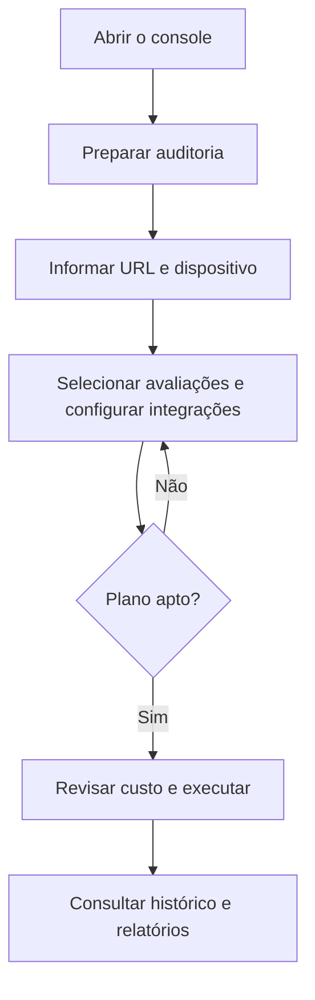

# Guia do usuário

Guia operacional do RASAi - Search & AI Readiness Auditor para execução local, configuração do console e leitura dos resultados. Descreve os contratos vigentes na `main`; a [última release pública](https://github.com/cardozo81/RASAI-Readiness-Auditor/releases/latest) é uma tag distinta e pode não incluir correções posteriores.

## Instalação local no Windows

O caminho recomendado é abrir `abrir-rasai-console.cmd` na raiz do projeto. Ele prepara o ambiente e inicia o console. A instalação manual abaixo é uma alternativa, não uma etapa adicional obrigatória. Veja [instalação](INSTALLATION.md).

```powershell
py -3.13 -m venv .venv
.\.venv\Scripts\Activate.ps1
python -m pip install -e .
python -m playwright install chromium
```

## Abrir o console

```powershell
rasai-console
```

Menu principal (representação textual, não captura de tela):

```text
1. Preparar auditoria
2. Auditorias / histórico
3. Relatórios consolidados
4. Inteligência Artificial
5. Integrações e serviços
6. Todas as configurações
7. Sistema / restaurar padrões
H. Ajuda
Q. Sair
```

## Fluxo recomendado

1. abra **Preparar auditoria**;
2. informe entrada, projeto, `Device`, idioma/mercado e timezone;
3. selecione um ou mais catálogos `CAT-*`;
4. configure imediatamente as particularidades mostradas no submenu de cada catálogo;
5. resolva qualquer catálogo `BLOQUEADO` antes de executar;
6. configure IA somente quando o plano escolhido puder ou precisar utilizá-la;
7. salve parâmetros não sensíveis na sessão/arquivo quando fizer sentido;
8. revise o estado do plano e a previsão de consumo/custo quando o fluxo canônico a apresentar;
9. execute;
10. leia o resultado distinguindo o que foi solicitado, não solicitado, limitado, falho ou indisponível.

### Jornada de uso



## Preparar auditoria

A tela atual usa:

```text
ESCOPO
CATÁLOGO DA AUDITORIA
PLANO DA PRÓXIMA AUDITORIA
EXECUÇÃO / ARMAZENAMENTO
AÇÕES
```

Não há Perfil da próxima auditoria. A seleção do usuário é o próprio plano de catálogos.

### Catálogos

```text
CAT-01 Fundamentos técnicos e descoberta
CAT-02 Acessibilidade
CAT-03 Conteúdo, semântica e dados estruturados
CAT-04 Web Performance
CAT-05 Search & AI Intelligence
CAT-06 Apdex de navegação
CAT-07 Apdex de experiência
CAT-08 Análise profunda e melhorias
CAT-09 Remediações
CAT-10 Segurança passiva
```

Selecionar um catálogo abre suas opções imediatamente. O operador não precisa atravessar uma sequência fixa de telas.

Cada submenu mostra estado, capacidades/fontes, configuração efetiva, uso de IA, resultado esperado, configurações relacionadas, persistência e ações.

### Estados

```text
APTO                 -> requisitos mínimos conhecidos atendidos
APTO COM LIMITAÇÕES  -> executável, mas com fonte/enriquecimento opcional indisponível
BLOQUEADO            -> falta requisito obrigatório do catálogo selecionado
NÃO SELECIONADO      -> fora do plano desta execução
```

Recurso não selecionado não deve bloquear o plano.

## Escopo e Device

`Device` pode ser:

```text
mobile
desktop
```

Cada AUD usa exatamente um contexto de device. Mobile e Desktop continuam dimensões/resultados compatíveis com comparação longitudinal, mas não são combinados na mesma nova AUD.

## IDs de configuração

Números curtos operam a tela atual. IDs canônicos identificam a mesma variável em qualquer caminho do console.

Ao abrir um catálogo, configurações relacionadas podem ser acessadas diretamente por seus IDs sem criar cópias da variável.

## Persistência

Após uma alteração não sensível, o console permite:

```text
1. manter somente nesta sessão
2. manter na sessão e salvar no arquivo de configuração
```

Secrets nunca entram no INI. O armazenamento Windows/User continua sendo usado somente por ação explícita.

A seleção `CAT-*` pertence ao plano da próxima execução. O snapshot secret-free do AUD registra essa seleção para reutilização e futura correspondência com os relatórios.

## Inteligência Artificial

Existe uma IA principal/orquestrador por execução.

```text
none       -> sem IA
provider   -> provider explicitamente selecionado
auto       -> orquestração canônica entre providers elegíveis
```

O catálogo informa onde IA é:

```text
NONE
OPTIONAL
REQUIRED
```

`CAT-03` pode usar IA para análise semântica/contextual; `CAT-05` tem IA competitiva opcional, sob opt-in e com comparação determinística habilitada; `CAT-08` usa IA como requisito de fechamento da análise profunda; `CAT-09` pode usar IA para remediações; `CAT-10` pode usar IA opcional para interpretação/remediação de segurança. Selecionar `CAT-01`, `CAT-02`, `CAT-04`, `CAT-06` ou `CAT-07` não aciona IA por seleção, e selecionar `CAT-05` não ativa sozinho a IA principal. Visibilidade em IA observada por integração não equivale a interpretação pela IA principal. IA advisory não altera evidência/scoring determinístico.

Quando somente recursos de IA opcionais estiverem no plano (`CAT-03`, `CAT-05` competitivo, `CAT-09` e/ou `CAT-10`), o plano começa em **Executar sem IA (recomendado)**. Se a IA principal estiver configurada, use `U. Executar com IA` para ativar o enriquecimento na próxima auditoria. Ao ativar IA, a previsão de consumo/custo aparece no fluxo canônico antes da escolha final entre executar com IA ou sem IA. Com `CAT-08`, a IA é obrigatória para o fechamento integral, mas sua ausência não impede a parte determinística nem a materialização do relatório.

AUTO mantém a política existente de custo, elegibilidade, disponibilidade, quarentena, circuit breaker, fallback e limite de tentativas.

Quando houver consumo estimável, o preview canônico ocorre antes da execução. A ação final apresenta `1. Executar auditoria com IA`, `2. Executar auditoria sem IA`, `A. Ajustar configuração de IA` e `V. Voltar`; escolher `1` ou `2` inicia a operação sem uma segunda confirmação da mesma intenção. Executar sem IA nesta AUD não remove a configuração de IA usada por auditorias futuras.

## Search & AI Intelligence

`CAT-05` agrupa o objetivo do usuário, mas mantém as fontes independentes:

- Search Intelligence / SERP;
- Google Search Console;
- Visibilidade em IA;
- observabilidade externa aplicável.

### SERP

Termos, depth, região, device e classificação competitiva continuam configuráveis. A profundidade representa a posição orgânica máxima tentada (`10 = Top 10`, `20 = Top 20`).

SERP com provider/key aptos mas sem termos ainda não produz a coleta; ao selecionar `CAT-05`, o console orienta a completar uma fonte Search suficiente.

### Google Search Console

GSC depende de OAuth, property, política e cobertura estrutural da URL. SERP e GSC não são dependência um do outro.

Quando GSC é obrigatório e incompatível, o catálogo bloqueia. Quando é automático/opcional e não aplicável, não deve transformar uma fonte Search válida em falha global.

Consulte [GSC_SCOPE_POLICY.md](GSC_SCOPE_POLICY.md).

## Web Performance

`CAT-04` usa os adapters/contratos atuais de PageSpeed, Lighthouse e CrUX conforme configuração.

Ausência de field data ou resposta externa é limitação/indisponibilidade; não deve ser convertida em score artificial.

## Apdex de navegação

`CAT-06` executa amostras sintéticas conforme thresholds, volume e carga configurados. O cálculo não depende de IA.

## Apdex de experiência

`CAT-07` é independente de `CAT-06`. É possível executar apenas Experience Apdex, apenas Navigation Apdex ou ambos; selecionar um deles não inclui o outro automaticamente.

O device do Experience é herdado integralmente da AUD:

```text
Device=mobile   -> 100% MOBILE
Device=desktop  -> 100% DESKTOP
```

Não existe `device_mix` público para novas AUDs e Tablet não é uma opção operacional. Os targets permanecem independentes: Navigation usa 150 amostras válidas por URL/device por default; Experience usa 100 amostras válidas por página por default.

Selecionar `CAT-07` não ativa IA. Qualquer correlação por IA pertence aos catálogos consumidores que a solicitam, como `CAT-08`.

## Análise profunda e melhorias

`CAT-08` consome evidências core persistidas da URL e interpreta apenas o contexto disponível para sua finalidade. Falta de evidência core necessária mantém a IA em `WAITING_FOR_DATA`, sem chamada ao provider. IA principal ausente/indisponível não bloqueia a auditoria: CAT-08 permanece como pendência explícita de fechamento até reprocessamento.

## Remediações

`CAT-09` transforma achados em ações técnicas/editoriais rastreáveis. Remediações determinísticas continuam válidas sem IA; IA pode enriquecer contextualização/exemplos sem alterar scoring por opinião.

## Segurança passiva

`CAT-10` usa evidências HTTP/browser/runtime já capturadas, incluindo headers, cookies, recursos e terceiros. Enriquecimentos OSV/KEV são externos e podem ficar indisponíveis sem caracterizar vulnerabilidade no alvo. Não executa exploração ativa; interpretação por IA é opcional e usa a configuração principal, quando autorizada. Consulte [contrato do catálogo](AUDIT_CATALOG_WORKFLOW.md) e [superfícies de relatório](CATALOG_AND_REPORT_SURFACES.md).

## Integrações e serviços

Use essa superfície para configurar GSC, SERP, PageSpeed/Lighthouse, CrUX, observabilidade e demais serviços publicados no catálogo técnico.

Diagnósticos de integração são consultivos: um teste bem-sucedido não garante disponibilidade futura e uma falha transitória não deve ser confundida automaticamente com erro de configuração.

## Todas as configurações

Cada variável deve informar finalidade, owner, contexto, valor/origem, estado, domínio/default e impacto. Booleanos/enums/listas fechadas usam seleção guiada; texto livre só é usado para domínios realmente abertos.

## Auditorias e histórico

Carregar configuração de um `AUD-*` prepara **nova execução** (`AUD-*` novo); o AUD de origem não é alterado e credenciais não são copiadas. Quando o snapshot contém `audit_catalog`, a lista `CAT-*` é restaurada junto da configuração não sensível.

Operações distintas sobre uma auditoria existente:

- **Reprocessar pendências (`RPR-*`)**: recupera requisitos ainda não atendidos do contrato do mesmo `AUD-*`, preservando os resultados válidos; uma AUD já `COMPLETE` não ganha novas pendências apenas por abrir RPR.
- **Complementar auditoria**: adiciona ao mesmo `AUD-*` catálogos ainda não solicitados, como extensão aditiva associada a um `RPR-*`, sem reconfigurar catálogos concluídos. Novas coletas live dependem da janela temporal válida; catálogos replay-safe podem reutilizar fontes persistidas.
- **Criar nova AUD**: refaz uma observação independente, necessária quando o escopo ou a validade temporal não permitem complemento legítimo.

Consulte o [contrato de reprocessamento e complemento](AUDIT_REPROCESSING.md) antes de escolher a operação.

## Relatórios

Os resultados persistidos alimentam **dois relatórios offline independentes**: `report-catalog` (inventário técnico e CAT-01..CAT-10) e `report-presentation` (leitura executiva). Ambos consomem a mesma fonte de verdade, sem depender do HTML um do outro e sem acionar IA para recriar fatos materializados. A publicação automática ocorre no fluxo de conclusão de auditoria conforme os contratos vigentes; `A` abre a apresentação e `I` abre o catálogo. A existência do HTML não prova, isoladamente, completude dos dados da AUD. Consulte [superfícies dos relatórios](CATALOG_AND_REPORT_SURFACES.md) e [guia de relatórios](REPORT_GUIDE.md).

A direção de UX é manter equivalência semântica:

```text
pedido no console -> configuração efetiva -> evidências/resultados -> relatório
```

Leia sempre separadamente medição determinística, indisponibilidade de fonte, execução parcial e conteúdo advisory por IA.

## CLI básica

O catálogo descrito neste documento é uma UX do `rasai-console`. A CLI tradicional mantém seus contratos próprios. Exemplos de **chamadas diretas à CLI** no PowerShell:

```powershell
rasai audit https://example.com --project "Exemplo"
rasai audit https://example.com --device-context desktop --ai-provider none
rasai reprocess AUD-EXEMPLO --audits-root audits
rasai consolidate AUD-BASE AUD-ATUAL --audits-root audits --selection-mode ALL
```

Use IDs reais nas duas últimas operações e consulte a [referência CLI](CLI_REFERENCE.md) para seleção de itens/IA. A ação **Ver linha de comando** oferece formatos separados para CMD e PowerShell 5.1/7. Escolha o formato do terminal em uso e consulte [execução externa](EXECUTION_SCHEDULING.md) para regras de escape, credenciais e limitações do comando planejado, especialmente nas pesquisas SERP e Perplexity.

## Segurança

- não copie API keys para issues, reports ou documentação;
- o INI não contém secrets;
- Windows/User só é alterado por ação explícita;
- key configurada não garante quota/saldo;
- Synthetic Apdex deve respeitar autorização e limites de carga;
- diagnóstico de integração é observação pontual, não garantia futura.

## Documentos relacionados

- [AUDIT_CATALOG_WORKFLOW.md](AUDIT_CATALOG_WORKFLOW.md)
- [AUDIT_REPROCESSING.md](AUDIT_REPROCESSING.md)
- [EXECUTION_SCHEDULING.md](EXECUTION_SCHEDULING.md)
- [CLI_REFERENCE.md](CLI_REFERENCE.md)
- [REPORT_GUIDE.md](REPORT_GUIDE.md)
- [INTERACTIVE_CONSOLE.md](INTERACTIVE_CONSOLE.md)
- [CONSOLE_CONFIGURATION_UX.md](CONSOLE_CONFIGURATION_UX.md)
- [CONSOLE_SEARCH_INTELLIGENCE.md](CONSOLE_SEARCH_INTELLIGENCE.md)
- [GSC_SCOPE_POLICY.md](GSC_SCOPE_POLICY.md)
- [CONTENT_ANALYSIS_CONTEXT.md](CONTENT_ANALYSIS_CONTEXT.md)
- [OUTPUTS_AND_ARTIFACTS.md](OUTPUTS_AND_ARTIFACTS.md)
